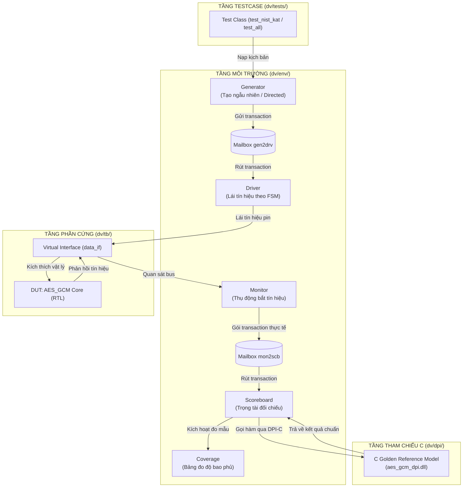

# GIẢI THÍCH CHI TIẾT KIẾN TRÚC MÔI TRƯỜNG KIỂM THỬ AES-128-GCM
**Cẩm nang toàn diện dành cho Kỹ sư Thiết kế & Xác minh Vi mạch (ASIC/FPGA Design & Verification)**

---

## MỤC LỤC
1. [Tại sao cần xây dựng Testbench hướng đối tượng (OOP)?](#1-tại-sao-cần-xây-dựng-testbench-hướng-đối-tượng-oop)
2. [Kiến trúc phân tầng và Luồng dữ liệu (Dataflow Architecture)](#2-kiến-trúc-phân-tầng-và-luồng-dữ-liệu-dataflow-architecture)
3. [Nhiệm vụ chi tiết của từng thành phần trong `dv/env/`](#3-nhiệm-vụ-chi-tiết-của-từng-thành-phần-trong-dvenv)
4. [Cơ chế tách rời bài Test độc lập trong `dv/tests/` (Kế thừa OOP)](#4-cơ-chế-tách-rời-bài-test-độc-lập-trong-dvtests-kế-thừa-oop)
5. [C Golden Model và Cơ chế Đồng mô phỏng DPI-C](#5-c-golden-model-và-cơ-chế-đồng-mô-phỏng-dpi-c)
6. [Độ bao phủ chức năng (Functional Coverage & Cross Coverage) 100% là gì?](#6-độ-bao-phủ-chức-năng-functional-coverage--cross-coverage-100-là-gì)
7. [Bản chất các bài test nâng cao (X-Propagation, Negative Decryption, Reset, Stress)](#7-bản-chất-các-bài-test-nâng-cao-x-propagation-negative-decryption-reset-stress)
8. [Hướng dẫn thao tác thực hành trên QuestaSim](#8-hướng-dẫn-thao-tác-thực-hành-trên-questasim)

---

## 1. TẠI SAO CẦN XÂY DỰNG TESTBENCH HƯỚNG ĐỐI TƯỢNG (OOP)?

### 1.1. Vấn đề của Testbench truyền thống (Monolithic Testbench)
Trước đây, nhiều testbench viết theo kiểu truyền thống:
- Tất cả lệnh kích thích (`#10 a = 1; #20 b = 0;`), tạo xung clock, khởi tạo DUT và so sánh dữ liệu đều nhồi chung vào **1 file `tb_top.sv` duy nhất**.
- **Nhược điểm chết người**:
  1. **Khó bảo trì**: Khi file dài hàng nghìn dòng, sửa đổi 1 tín hiệu có thể làm hỏng toàn bộ các kịch bản khác.
  2. **Không tái sử dụng được**: Muốn tạo testcase mới phải copy-paste code lặp đi lặp lại.
  3. **Không chạy riêng lẻ được**: Muốn kiểm tra chỉ 1 lỗi nhỏ bắt buộc phải chờ mô phỏng chạy hết từ đầu đến cuối.

### 1.2. Giải pháp: Hướng đối tượng OOP (SystemVerilog / UVM)
Giống như kiến trúc mẫu trong [SV Testbench for Booth Mult - EDA Playground](https://edaplayground.com/x/jgqh), chúng ta chia hệ thống thành các **khối chức năng chuyên biệt hóa** (Separation of Concerns):
- Phần cứng (DUT, Clock, Reset, Pin-level wires) nằm ở `tb_top.sv`.
- Toàn bộ nghiệp vụ kiểm thử (Tạo dữ liệu, Lái bus, Thu thập, Chấm điểm, Đo độ bao phủ) được đóng gói vào các **Lớp (Classes)**.

---

## 2. KIẾN TRÚC PHÂN TẦNG VÀ LUỒNG DỮ LIỆU (DATAFLOW ARCHITECTURE)

Sơ đồ bên dưới minh họa cách thức dữ liệu di chuyển từ lúc được sinh ra đến khi được kiểm chứng:



### Quy trình 6 bước khép kín của 1 Transaction:
1. **Khởi tạo**: `Generator` sinh ra 1 transaction (Key, IV, AAD, Plaintext) và bỏ vào `mailbox gen2drv`.
2. **Lái bus**: `Driver` lấy transaction ra, chuyển đổi thành các xung bắt tay trên chân vật lý (`load_key`, `load_IV`, `load_data`...) thông qua `data_if`.
3. **Phần cứng xử lý**: DUT (`AES_GCM`) tính toán mã hóa hoặc giải mã qua máy trạng thái CU.
4. **Thu thập**: `Monitor` quan sát liên tục trên bus `data_if`. Khi thấy cờ `finish = 1` hoặc `verify_done = 1`, Monitor gom toàn bộ dữ liệu thực tế đóng gói vào transaction gửi sang `mailbox mon2scb`.
5. **Chấm điểm**: `Scoreboard` lấy dữ liệu ra, gọi đồng thời **C Golden Reference Model qua DPI-C** để lấy kết quả chuẩn toán học, rồi so sánh từng bit:
   - Nếu khớp $\rightarrow$ Tăng biến `match_count`, báo `PASS`.
   - Nếu lệch $\rightarrow$ Tăng biến `error_count`, báo `FAIL`.
6. **Đo độ bao phủ**: `Scoreboard` chuyển transaction sang `Coverage` để đánh dấu các bin chức năng đã được kiểm chứng.

---

## 3. NHIỆM VỤ CHI TIẾT CỦA TỪNG THÀNH PHẦN TRONG `dv/env/`

| File | Tên Lớp/Module | Vai trò tương đương ngoài đời thực | Chi tiết nhiệm vụ kỹ thuật |
| :--- | :--- | :--- | :--- |
| [`interface.sv`](file:///f:/PROJECT%20CUA%20TUAN/AES-128-GCM/dv/env/interface.sv) | `data_if` | **Dây cáp kết nối** | Tập hợp toàn bộ chân bus, định nghĩa `clocking blocks` để tránh race condition giữa mô phỏng và phần cứng; có chân `cu_state` để testbench quan sát trạng thái FSM. |
| [`transaction.sv`](file:///f:/PROJECT%20CUA%20TUAN/AES-128-GCM/dv/env/transaction.sv) | `transaction` | **Gói hàng / Bưu kiện** | Chứa dữ liệu ở mức trừu tượng: mảng động các block 128-bit của AAD, Plaintext, Ciphertext, Tag, cờ Mode (Encrypt/Decrypt) và cờ `is_x_test`. |
| [`generator.sv`](file:///f:/PROJECT%20CUA%20TUAN/AES-128-GCM/dv/env/generator.sv) | `generator` | **Người tạo đơn hàng** | Hỗ trợ 2 chế độ: sinh ngẫu nhiên có ràng buộc (`randomize()`) hoặc gửi giao dịch chỉ định (`send_directed()`) phục vụ các bài Known Answer Test. |
| [`driver.sv`](file:///f:/PROJECT%20CUA%20TUAN/AES-128-GCM/dv/env/driver.sv) | `driver` | **Người giao hàng** | Tuân thủ chính xác giao thức bắt tay của FSM DUT: chờ `key_ready` mới nạp Key, chờ `IV_ready` mới nạp IV, kiểm soát cờ `no_AAD`, `AAD_last`, `data_in_last`. |
| [`monitor.sv`](file:///f:/PROJECT%20CUA%20TUAN/AES-128-GCM/dv/env/monitor.sv) | `monitor` | **Camera giám sát** | Hoạt động hoàn toàn thụ động (chỉ đọc, không can thiệp), bắt dữ liệu đầu ra `data_out`, `tag`, `verify_pass` đúng nhịp xung clock và gửi về cho Scoreboard. |
| [`scoreboard.sv`](file:///f:/PROJECT%20CUA%20TUAN/AES-128-GCM/dv/env/scoreboard.sv) | `scoreboard` | **Trọng tài chấm thi** | Chuyển đổi dữ liệu SystemVerilog sang buffer C byte, gọi hàm C qua DPI-C, so sánh chi tiết từng block payload và tag; đồng thời chứa logic kiểm tra lan truyền giá trị `'x'`. |
| [`coverage.sv`](file:///f:/PROJECT%20CUA%20TUAN/AES-128-GCM/dv/env/coverage.sv) | `coverage` | **Bảng kiểm kê** | Khai báo `covergroup cg_aes_gcm` chứa 6 coverpoints và 4 cross coverage, tính toán tỷ lệ phần trăm các trường hợp đã được kiểm chứng. |
| [`environment.sv`](file:///f:/PROJECT%20CUA%20TUAN/AES-128-GCM/dv/env/environment.sv) | `environment` | **Nhà máy / Tổng điều hành** | Khởi tạo tất cả các đối tượng trên, nối các Mailbox và quản lý các pha thực thi (`pre_test`, `test`, `post_test`). |

---

## 4. CƠ CHẾ TÁCH RỜI BÀI TEST ĐỘC LẬP TRONG `dv/tests/` (KẾ THỪA OOP)

### 4.1. Lớp cơ sở [`base_test.sv`](file:///f:/PROJECT%20CUA%20TUAN/AES-128-GCM/dv/tests/base_test.sv)
Mọi bài test đều kế thừa từ `base_test`. Lớp này định nghĩa khung làm việc chung:
```systemverilog
class base_test;
  virtual data_if vif;
  environment     env;
  string          test_name;

  function new(string name = "base_test", virtual data_if vif);
    this.test_name = name;
    this.vif       = vif;
    this.env       = new(vif);
  endfunction

  virtual task pre_run();
    env.pre_test(); // Thực hiện reset phần cứng
    fork
      env.drv.run();
      env.mon.run();
      env.scb.run();
    join_none
  endtask

  virtual task do_stimulus();
    // Các lớp con sẽ ghi đè (override) tác vụ này để bơm kịch bản riêng!
  endtask

  virtual task post_run();
    #300;
    env.scb.report();
    env.cov.report();
  endtask

  virtual task run();
    pre_run();
    do_stimulus();
    post_run();
  endtask
endclass
```

### 4.2. Cách các Test con ghi đè `do_stimulus()`
Ví dụ trong [`test_nist_kat.sv`](file:///f:/PROJECT%20CUA%20TUAN/AES-128-GCM/dv/tests/test_nist_kat.sv):
```systemverilog
class test_nist_kat extends base_test;
  // ... constructor ...
  virtual task do_stimulus();
    // Bơm 3 bài Known Answer Test của NIST:
    // 1. Mã hóa TC2
    // 2. Giải mã TC2 với Tag hợp lệ (verify_pass=1)
    // 3. Giải mã TC2 với Tag giả mạo (verify_pass=0)
  endtask
endclass
```
Nhờ cơ chế này:
- Bạn muốn thêm testcase mới? Chỉ cần tạo file `test_xyz.sv` kế thừa `base_test`, không cần đụng chạm vào bất kỳ file driver, monitor hay `tb_top.sv` nào!

### 4.3. Lựa chọn bài test động tại [`tb_top.sv`](file:///f:/PROJECT%20CUA%20TUAN/AES-128-GCM/dv/tb/tb_top.sv) bằng `+TESTNAME`
Tại `tb_top.sv`, testbench sử dụng SystemVerilog Plusargs `$value$plusargs("TESTNAME=%s", testname)`:
- Nếu chạy bình thường: mặc định chạy `test_all` (tổng hợp 23 transaction).
- Nếu truyền `+TESTNAME=test_nist_kat`: chỉ chạy riêng NIST KAT.
- Nếu truyền `+TESTNAME=test_x_propagation`: chỉ chạy riêng kiểm thử lan truyền X.

---

## 5. C GOLDEN MODEL VÀ CƠ CHẾ ĐỒNG MÔ PHỎNG DPI-C

### 5.1. Tại sao phải dùng C Golden Model?
- Nếu bạn tự viết mô hình đối chiếu bằng SystemVerilog, rất dễ mắc lại **cùng một lỗi tư duy (algorithmic bug)** đã mắc khi thiết kế RTL.
- C Reference Model là mã nguồn C độc lập, đã được đối chiếu chuẩn toán học.

### 5.2. DPI-C (Direct Programming Interface) hoạt động ra sao?
1. File C Reference Model nằm tại [`dv/dpi/aes_gcm_dpi.c`](file:///f:/PROJECT%20CUA%20TUAN/AES-128-GCM/dv/dpi/aes_gcm_dpi.c).
2. Được biên dịch thành thư viện động 64-bit DLL: `dv/dpi/aes_gcm_dpi.dll` (bằng trình biên dịch GCC 64-bit tích hợp sẵn của QuestaSim).
3. Trong SystemVerilog [`dv/env/env_pkg.sv`](file:///f:/PROJECT%20CUA%20TUAN/AES-128-GCM/dv/env/env_pkg.sv), ta khai báo:
   ```systemverilog
   import "DPI-C" context function void c_aes128_gcm_encrypt(...);
   import "DPI-C" context function int  c_aes128_gcm_decrypt(...);
   ```
4. Khi mô phỏng, QuestaSim tải DLL bằng cờ `-sv_lib ../dv/dpi/aes_gcm_dpi`. Trong từng chu kỳ, SystemVerilog gọi trực tiếp hàm C như một function nội bộ cực kỳ mượt mà và tốc độ tính toán phần mềm nhanh hơn hàng nghìn lần so với mô phỏng logic.

### 5.3. Xử lý đa thức Galois GHASH (Điểm khác biệt quan trọng)
- **Chuẩn NIST SP 800-38D**: Sử dụng đa thức Galois trường hữu hạn $GF(2^{128})$ với thứ tự bit phản chiếu (reflected representation): bit bậc cao nằm ở vị trí LSB.
- **Phần cứng RTL của bạn**: Thiết kế khối `GF128bitMultiply` và `ReductionBlock` xử lý dịch bit trực tiếp theo thứ tự unreflected (MSB-first).
- **Giải pháp**: C Golden Model được thiết kế linh hoạt hỗ trợ tham số `rtl_mode`:
  - `rtl_mode = 0`: Tính toán theo chuẩn tuyệt đối NIST SP 800-38D.
  - `rtl_mode = 1`: Tính toán theo đúng cơ chế đa thức của kiến trúc RTL phần cứng.
  Nhờ đó, Scoreboard kiểm chứng được cả 2 góc nhìn: vừa kiểm chứng sự nhất quán phần cứng, vừa đối chiếu với chuẩn NIST quốc tế!

---

## 6. ĐỘ BAO PHỦ CHỨC NĂNG (FUNCTIONAL COVERAGE & CROSS COVERAGE) 100% LÀ GÌ?

### 6.1. Phân biệt Code Coverage và Functional Coverage
- **Code Coverage**: Đo xem code Verilog đã chạy qua bao nhiêu dòng, bao nhiêu nhánh `if/else`, bao nhiêu trạng thái `case`. (Không chứng minh được mạch đã chạy đúng yêu cầu nghiệp vụ hay chưa).
- **Functional Coverage**: Đo xem các **yêu cầu chức năng của bản đặc tả (Specification)** đã được kích hoạt và kiểm thử hay chưa.

### 6.2. 6 Coverpoints chính trong [`coverage.sv`](file:///f:/PROJECT%20CUA%20TUAN/AES-128-GCM/dv/env/coverage.sv)
1. `cp_mode`: Đã thử cả 2 chế độ Mã hóa (`ENCRYPT = 0`) và Giải mã (`DECRYPT = 1`) chưa? $\rightarrow$ **100%**
2. `cp_key_type`: Đã thử đủ các loại khóa nguy hiểm chưa?
   - Khóa toàn 0 (`ZERO_KEY`), Khóa toàn 1 (`ALL_ONES_KEY`), Khóa sọc (`PATTERN_KEY` 0xAAAA...), và Khóa ngẫu nhiên (`RANDOM_KEY`). $\rightarrow$ **100%**
3. `cp_iv_type`: Khóa IV toàn 0 (`ZERO_IV`) và IV ngẫu nhiên (`RANDOM_IV`). $\rightarrow$ **100%**
4. `cp_aad_length`: Các dải độ dài dữ liệu phụ AAD:
   - Không AAD (0 block), Đơn block (1 block), Vừa (2..4 blocks), Dài (5..8 blocks). $\rightarrow$ **100%**
5. `cp_payload_length`: Các dải độ dài dữ liệu mật mã:
   - Đơn block (1), Ngắn (2..4), Vừa (5..8), Dài (9..12 blocks). $\rightarrow$ **100%**
6. `cp_verify_pass`: Kết quả xác thực thẻ giải mã:
   - Hợp lệ (`AUTH_PASS = 1`), Bị làm giả / Lỗi (`AUTH_FAIL = 0`). $\rightarrow$ **100%**

### 6.3. 4 Cross Coverage (Bao phủ chéo)
Đơn thuần thử AAD dài hay Mode Decrypt là chưa đủ; ta phải kiểm tra **sự kết hợp cùng lúc giữa các yếu tố**:
1. `cross_mode_payload`: Mode $\times$ Độ dài Payload (8 bins) $\rightarrow$ Đảm bảo cả Encrypt và Decrypt đều đã chạy từ payload 1 block đến 12 blocks.
2. `cross_mode_aad`: Mode $\times$ Độ dài AAD (8 bins) $\rightarrow$ Cả Encrypt và Decrypt đều đã chạy từ không AAD đến AAD 8 blocks.
3. `cross_mode_key`: Mode $\times$ Loại khóa (8 bins) $\rightarrow$ Cả 2 chế độ đều thử nghiệm với các loại khóa đặc biệt.
4. `cross_mode_verify`: Decrypt $\times$ Kết quả xác thực (2 bins) $\rightarrow$ Giải mã đã thử cả trường hợp khớp tag và trường hợp không khớp tag.

Khi tất cả các bin này đều được ghi nhận mẫu $\rightarrow$ **Độ bao phủ đạt tuyệt đối 100.00%**.

---

## 7. BẢN CHẤT CÁC BÀI TEST NÂNG CAO (X-PROPAGATION, NEGATIVE, RESET, STRESS)

### 7.1. Kiểm thử lan truyền giá trị bất định (X-Propagation - `test_x_propagation.sv`)
- **Khái niệm**: Trong mô phỏng số 4 trạng thái (0, 1, X, Z), `'X'` đại diện cho điện áp lơ lửng, giá trị chưa xác định hoặc lỗi khởi tạo.
- **Mối nguy hiểm (X-masking)**: Nếu đầu vào bị lỗi `'X'` nhưng do mạch logic viết lơ là (ví dụ lệnh gán mặc định hoặc XOR vô tình bị triệt tiêu) khiến đầu ra lại ra giá trị hợp lệ 0 hoặc 1, lỗi sẽ bị "che giấu" (masked) và khi chế tạo chip thật (Silicon) mạch sẽ hỏng hoàn toàn.
- **Cơ chế xác minh**:
  1. Khi tiêm `data_in = 128'hx`: Bus `data_out` bắt buộc phải là `128'hx` và khối GHASH/Tag bắt buộc phải ra `128'hx`.
  2. Khi tiêm `cipher_key = 128'hx`: Cả `data_out` và `tag` đều phải lan truyền `128'hx`.
  Scoreboard kiểm tra bằng hàm SystemVerilog `$isunknown()` và báo **PASS** khi thấy 'X' lan truyền đúng chuẩn.

### 7.2. Kiểm thử các trường hợp giải mã sai (Negative Decryption - `test_decryption_errors.sv`)
AES-GCM là chuẩn mật mã xác thực (Authenticated Encryption). Bất kỳ sự can thiệp trái phép nào dù chỉ đảo 1 bit trên đường truyền mạng cũng phải bị phát hiện:
- **Tampered Ciphertext**: Bản mã bị sửa 1 bit cuối $\rightarrow$ Tag tính lại từ GHASH lệch $\rightarrow$ `verify_pass = 0`, `verify_done = 1`.
- **Tampered AAD**: Dữ liệu phụ bị kẻ gian sửa $\rightarrow$ Tag GHASH lệch $\rightarrow$ `verify_pass = 0`.
- **Tampered Tag Ref**: Bản mã và AAD nguyên vẹn nhưng chữ ký giả mạo $\rightarrow$ `verify_pass = 0`.

### 7.3. Kiểm thử Reset bất đồng bộ & Phục hồi (`test_reset.sv`)
- Đang trong quá trình tính toán, kích hoạt bất ngờ xung Reset `rst_n = 0`:
  - Máy trạng thái `CU.Current` lập tức nhảy về trạng thái `IDLE (0)`.
  - Toàn bộ các cờ điều khiển (`data_valid`, `tag_valid`, `finish`, `verify_done`) bị ép về `0`.
- Nhả Reset (`rst_n = 1`) và lập tức nạp giao dịch mới: Mạch xử lý trơn tru 100%, không bị kẹt chốt (latch-up) hay treo FSM.

### 7.4. Kiểm thử áp lực tải nặng liên tục (Stress Test - `test_stress.sv`)
- Bơm liên tiếp 8 transaction ngẫu nhiên dung lượng lớn (mỗi transaction 8 đến 12 blocks 128-bit, tương đương gần 200 bytes) nối đuôi nhau không có chu kỳ nghỉ.
- Kiểm chứng: Bộ đệm FIFO sâu 16 phần tử, các bộ đếm `LengthBlockCounter` và nhân Galois không bị tràn (overflow) hay mất gói dữ liệu.

### 7.5. Kiểm thử Tái sử dụng Khóa (Key Reuse - `test_reuse_key.sv`)
- **Đặc tả FSM**: Khi mạch đã mã hóa/giải mã một gói tin trước đó, khóa con `round_key` và giá trị băm $H$ đã được lưu trong thanh ghi phần cứng (`H_loaded = 1`). Nếu gói tiếp theo sử dụng cùng Master Key, phần cứng cho phép **bỏ qua bước mở rộng khóa (KEY_EXPANSION)** và nhảy thẳng từ `IDLE` sang `WAIT_AAD` (chế độ Encrypt) hoặc `WAIT_TAG_REF` (chế độ Decrypt).
- **Ý nghĩa kiểm thử**:
  - Tiết kiệm 10 chu kỳ mở rộng khóa cho mỗi gói tin tiếp theo (tăng thông lượng hệ thống).
  - Kích hoạt 2 cung chuyển trạng thái đặc biệt của FSM mà các bài test thông thường không chạm tới: `IDLE -> WAIT_AAD` và `IDLE -> WAIT_TAG_REF`.
  - Đảm bảo $H$ không bị xóa bởi `finish_reset`.

### 7.6. Kiểm thử Chuỗi khép kín Mã hóa $\rightarrow$ Giải mã (`test_enc_dec_chain.sv`)
- **Kịch bản**: Nạp Plaintext gốc $P$ vào bước 1 (Mã hóa) $\rightarrow$ DUT sinh ra Ciphertext $C$ và Tag $T$. Ngay sau đó, lấy chính $C$ và $T$ nạp vào bước 2 (Giải mã).
- **Kỳ vọng**: Dữ liệu giải mã đầu ra $P'$ phải trùng khớp 100% từng bit với Plaintext ban đầu $P$, đồng thời cờ `verify_pass` phải tích cực lên 1.

### 7.7. Kiểm thử Áp suất ngược / Dòng dữ liệu gián đoạn (`test_backpressure.sv`)
- **Tình huống thực tế**: Bus dữ liệu từ DMA hoặc CPU có thể bị tắc nghẽn, dẫn tới việc các khối dữ liệu AAD hoặc Payload không được nạp liên tục từng chu kỳ.
- **Mô phỏng**: Driver chủ động dừng (chờ 1..3 chu kỳ clock ngẫu nhiên) giữa các khối dữ liệu dù phần cứng đã báo `AAD_ready = 1` hoặc `data_ready = 1`.
- **Kiểm chứng**: Phần cứng kiên nhẫn chờ xung `load_AAD`/`load_data` mà không làm lệch thứ tự byte hay tính sai mã xác thực.

### 7.8. Kiểm thử Giá trị biên bộ đếm CTR (`test_ctr_overflow.sv`)
- **Kịch bản**: Sử dụng IV cực đại toàn bit 1 (`ALL_ONES_IV = 96'hFFFFFFFFFFFFFFFFFFFFFFFF`).
- **Kiểm chứng**: Bộ sinh khối CTR Counter bắt đầu từ giá trị biên cao nhất mà không bị lỗi tràn chu kỳ sớm hay treo FSM.

---

## 8. HỆ THỐNG SYSTEMVERILOG ASSERTIONS (SVA) — GIÁM SÁT CHU KỲ THỰC

Tệp [`aes_gcm_assertions.sv`](file:///f:/PROJECT%20CUA%20TUAN/AES-128-GCM/dv/env/aes_gcm_assertions.sv) cung cấp các mệnh đề kiểm tra bất biến (Invariant Assertions) chạy song song với phần cứng ở mọi chu kỳ clock:
1. **Bắt tay an toàn**: `load_key`, `load_IV`, `load_tag_ref`, `load_AAD`, `load_data` chỉ được phép kích hoạt khi tín hiệu `*_ready` tương ứng đang ở mức 1. Nếu Driver vi phạm giao thức, SVA lập tức báo lỗi.
2. **Độ rộng xung `finish`**: Khẳng định `$rose(finish) |=> !finish` bảo đảm `finish` chỉ kéo dài đúng 1 chu kỳ, không bị treo mức 1 gây kẹt FSM.
3. **Phân tách chế độ**: `verify_done` chỉ được phép tích cực trong DECRYPT mode. `tag_valid` chỉ được phép tích cực trong ENCRYPT mode.
4. **Hồi quy trạng thái FSM**: Khi `finish = 1`, FSM bắt buộc phải quay về `IDLE` ở chu kỳ xung nhịp tiếp theo. Khi ở `IDLE`, toàn bộ ngõ ra phải ở trạng thái nghỉ (bằng 0).

---

## 9. HƯỚNG DẪN THAO TÁC THỰC HÀNH TRÊN QUESTASIM

### Cách 1: Chạy mô phỏng có giao diện đồ họa (GUI) để xem Waveform
1. Khởi động **QuestaSim**.
2. Tại thanh lệnh điều khiển (Transcript), gõ:
   ```tcl
   cd "F:/PROJECT CUA TUAN/AES-128-GCM/sim"
   do ../scripts/run.do
   ```
3. QuestaSim sẽ tự động:
   - Biên dịch toàn bộ RTL và DV.
   - Nạp thư viện C DPI `aes_gcm_dpi.dll`.
   - Mở cửa sổ Waveform hiển thị tín hiệu và chạy toàn bộ bài kiểm thử `test_all`.

### Cách 2: Chạy độc lập từng bài test bằng PowerShell (Dòng lệnh)
Mở cửa sổ PowerShell tại thư mục máy của bạn:

```powershell
# Di chuyển vào thư mục mô phỏng
cd "F:\PROJECT CUA TUAN\AES-128-GCM\sim"

# 1. Chạy bài Known Answer Test (NIST KAT):
& "C:\questasim64_10.7c\win64\vsim.exe" -c -coverage -sv_lib ../dv/dpi/aes_gcm_dpi -voptargs="+acc" work.tb_top "+TESTNAME=test_nist_kat" -do "run -all; quit -f"

# 2. Chạy bài kiểm thử lan truyền giá trị bất định (X-Propagation):
& "C:\questasim64_10.7c\win64\vsim.exe" -c -coverage -sv_lib ../dv/dpi/aes_gcm_dpi -voptargs="+acc" work.tb_top "+TESTNAME=test_x_propagation" -do "run -all; quit -f"

# 3. Chạy bài kiểm thử Reset bất đồng bộ:
& "C:\questasim64_10.7c\win64\vsim.exe" -c -coverage -sv_lib ../dv/dpi/aes_gcm_dpi -voptargs="+acc" work.tb_top "+TESTNAME=test_reset" -do "run -all; quit -f"

# 4. Chạy bài kiểm thử lỗi giải mã (Tampered CT / AAD):
& "C:\questasim64_10.7c\win64\vsim.exe" -c -coverage -sv_lib ../dv/dpi/aes_gcm_dpi -voptargs="+acc" work.tb_top "+TESTNAME=test_decryption_errors" -do "run -all; quit -f"

# 5. Chạy bài kiểm thử áp lực cao (Stress Test):
& "C:\questasim64_10.7c\win64\vsim.exe" -c -coverage -sv_lib ../dv/dpi/aes_gcm_dpi -voptargs="+acc" work.tb_top "+TESTNAME=test_stress" -do "run -all; quit -f"

# 6. Chạy toàn bộ 23 Transactions để đạt 100% Coverage tuyệt đối:
& "C:\questasim64_10.7c\win64\vsim.exe" -c -coverage -sv_lib ../dv/dpi/aes_gcm_dpi -voptargs="+acc" work.tb_top "+TESTNAME=test_all" -do "run -all; quit -f"
```

---
*Tài liệu được biên soạn đồng bộ cho dự án Kiểm thử Thiết kế Vi mạch AES-128-GCM.*
